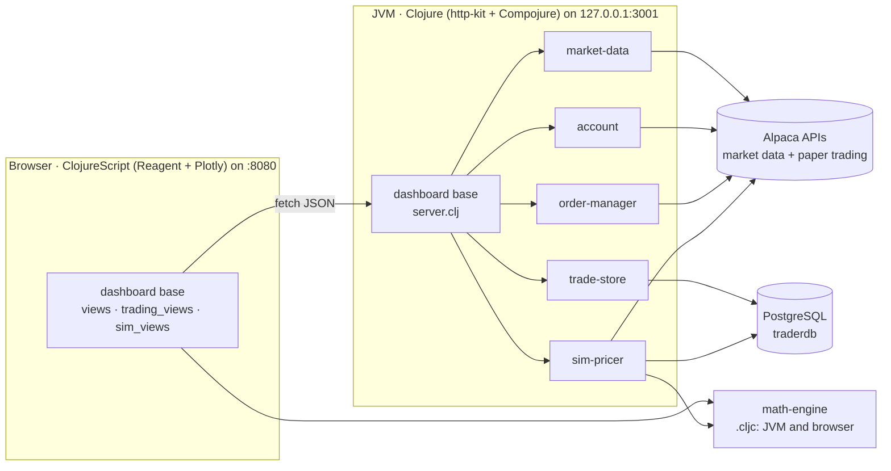

# Spread Viz

An options-trading workbench in Clojure and ClojureScript. It visualises the profit and loss of
option spreads over price and time, places multi-leg orders on an
[Alpaca](https://alpaca.markets) **paper-trading** account, keeps a trade journal in PostgreSQL,
and replays strategies against simulated option chains built from real price history.

> **Paper trading only.** Orders go to `paper-api.alpaca.markets`, Alpaca's simulated brokerage,
> not a live account. This is a personal learning project, not financial advice.

## Features

The dashboard has five tabs.

| Tab | What it does |
|---|---|
| **P&L Visualizer** | Heatmap of a vertical spread's P&L across underlying price (x) and days to expiry (y), priced with Black-Scholes. Overlays ±1σ expected-move bands. A **Fetch Live** button pulls the spot price and at-the-money IV from Alpaca. |
| **Trade** | Order tickets for 8 instruments: stock, single option, vertical, calendar, diagonal, butterfly (symmetric or broken-wing), iron condor and back-ratio spread. Multi-leg orders are sent as Alpaca `mleg` orders, and each one is recorded in the trade journal. |
| **Positions** | Account equity, cash and buying power, plus open positions with unrealised P&L. |
| **History** | The trade journal: open and closed trades with their legs, close or cancel actions, and a performance summary (win rate, total P&L). |
| **Simulator** | Downloads daily price history for a ticker, generates a synthetic option chain for every day, and lets you open and close vertical, butterfly and back-ratio trades "in the past", marking P&L on any date. |

## Architecture

The code is a [Polylith](https://polylith.gitbook.io/) workspace. Each **component** has one
responsibility and exposes an `interface` namespace. The **base** (`dashboard`) wires the
components into an HTTP API and a browser app.



| Brick | Kind | Responsibility |
|---|---|---|
| `math-engine` | component (`.cljc`) | Black-Scholes pricing, spread P&L, P&L grids, price-probability density, ±1σ expected move. Shared by the server and the browser. On the JVM it uses Apache Commons Math; in ClojureScript an Abramowitz-Stegun `erf` approximation. |
| `market-data` | component | Alpaca market data: latest quote, option snapshots (IV, delta), ATM IV for an expiry. |
| `account` | component | Alpaca paper account, positions and orders. |
| `order-manager` | component | OCC option symbols and order placement for every supported structure, plus cancel and look-up. |
| `trade-store` | component | PostgreSQL trade journal (`trader` schema: `trades`, `legs`), HikariCP pool, P&L on close, performance summary. |
| `sim-pricer` | component | Historical simulator (`sim` schema): Alpaca daily bars, EWMA volatility, synthetic chains, simulated trades and their P&L. |
| `dashboard` | base | `server.clj` (REST API) and the Reagent UI (`core`, `views`, `trading_views`, `sim_views`), with `resources/public/index.html`. |
| `dashboard-app` | project | Deployable artifact: an uberjar of the server (`projects/dashboard-app`). |

**Stack:** Clojure 1.12, ClojureScript 1.11 via shadow-cljs, Reagent (React 17), Plotly.js,
http-kit, Ring/Compojure, next.jdbc + HikariCP, PostgreSQL, Apache Commons Math.

## How the numbers are made

- **Option prices:** Black-Scholes, with time in years (`days / 365`).
- **Spread P&L** (`math-engine/spread-pnl`): current value of the legs (long minus short) + the
  initial credit (positive) or debit (negative).
- **Probability overlay:** the density of the underlying at each grid price, modelled as a
  *normal* distribution centred on spot with σ = spot × IV × √t. This is a simplification: prices
  are usually modelled as lognormal, which skews upward.
- **Expected move:** spot ± spot × IV × √t (one standard deviation).
- **Simulator chains** (`sim-pricer`):
  - Volatility: EWMA of daily log returns, λ = 0.94 (the RiskMetrics convention), seeded with the
    variance of the first 20 returns and annualised over 252 trading days.
  - Chain: strikes from 75% to 125% of each day's close (step $0.50, $1, $2.50 or $5 as the price
    rises), expiries at **30 / 60 / 90 / 180 days**, priced with Black-Scholes at a 5%
    risk-free rate.
  - Spreads: bid and ask at ±3% of mid, with a 5¢ minimum half-spread and bids floored at 1¢.
  - Fills: sim trades fill at the bid when selling and the ask when buying.

### Trade journal sign convention

Option premiums are **signed per share**: a **credit received is positive** and a **debit paid is
negative**. This is how order tickets ask for the limit price, how `open-value` is stored, and how
to enter the closing premium on the History tab.

- **Options:** P&L = (open + close) × contracts × 100. Sell a spread for **+1.50**, buy it back
  for **−0.40**: P&L = +$110 per contract.
- **Stock:** open and close are prices per share, and the P&L accounts for the side, so a short
  position gains when the price falls.
- **Market orders:** these have no limit price. Stock records the current quote as an estimate,
  and options record 0. The trade's notes say so in both cases.

## Getting started

### Prerequisites

- JDK 21+ and the [Clojure CLI](https://clojure.org/guides/install_clojure)
- Node.js and npm (for shadow-cljs and the npm packages)
- PostgreSQL with an empty database named `traderdb`. The `trader` and `sim` schemas are created
  automatically on startup.
- An Alpaca account with **paper-trading** API keys. Option snapshots request the `opra` feed;
  check that your Alpaca market-data plan includes it.

### Configuration

All settings come from environment variables. Secrets are never stored in the repository.

| Variable | Used by | Default |
|---|---|---|
| `APCA_API_KEY_ID` / `APCA_API_SECRET_KEY` | market-data, account, order-manager, sim-pricer | (required) |
| `TRADER_DB_URL` | trade-store, sim-pricer | `jdbc:postgresql://localhost:5432/traderdb` |
| `TRADER_DB_USER` / `TRADER_DB_PASSWORD` | trade-store, sim-pricer | driver default |
| `SPREAD_VIZ_HOST` | API server: interface to listen on | `127.0.0.1` |
| `SPREAD_VIZ_PORT` | API server: port | `3001` |
| `SPREAD_VIZ_ALLOWED_ORIGINS` | API server: comma-separated browser origins allowed by CORS | `http://localhost:8080,http://127.0.0.1:8080` |
| `SPREAD_VIZ_API` | front-end build: where the browser finds the API | `http://localhost:3001` |

### Run it

1. **Start the API server** on http://127.0.0.1:3001:

   ```bash
   clojure -M:server
   ```

   Or from a REPL, `clojure -M:dev`, then `(require 'dev.user)` and `(dev.user/start)`. The REPL
   also has `stop` and `restart`.

2. **Start the front end** with hot reload, served on http://localhost:8080:

   ```bash
   npm install
   npx shadow-cljs watch app
   ```

### Tests and tooling

```bash
# Unit tests: pricing, P&L conventions, and the server's localhost/CORS checks
clojure -M:dev:test -e "(require 'clojure.test 'jotis.viz.math-engine.interface-test \
  'jotis.viz.trade-store.interface-test 'jotis.viz.dashboard.server-test) \
  (clojure.test/run-all-tests #\"jotis\\..*-test\")"

clojure -M:poly check   # validate the Polylith workspace
clojure -M:poly info    # bricks, projects, and what has changed

# Build the deployable server
cd projects/dashboard-app && clojure -M:uberjar   # -> target/dashboard-app.jar
```

## Security

The API server places real orders on your Alpaca paper account and has no login, so it's
locked to your machine:

- **It listens on `127.0.0.1` only,** so other machines on your network can't connect. Setting
  `SPREAD_VIZ_HOST` to `0.0.0.0` exposes it, so don't do that without adding authentication.
- **CORS allows only the dashboard's origin.** Other websites can't read API responses. They also
  can't send the JSON `POST` and `DELETE` requests that place and cancel orders, because those
  need a CORS preflight, which is refused.
- **DNS rebinding is blocked.** A malicious site could point its own domain name at `127.0.0.1` to
  look same-origin. The server rejects any request whose `Host` header isn't localhost, and any
  request from an origin that isn't allowed.

Before switching to a **live** Alpaca account, add real authentication. A per-user token checked
on every request is the minimum.
